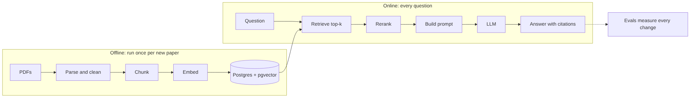
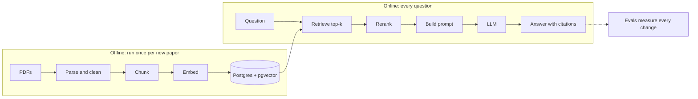

# Course: Build a production-shaped RAG system in 14 days

You build one project, **arXiv Paper Curator**: ask a question about a folder of research papers and get an answer that cites the paper and page it came from.

Each day has its own folder with a `README.md` that covers:

1. **What you'll study**: the concepts for that day
2. **Explained simply**: plain-language explanations with everyday examples
3. **Diagram**: how the pieces fit together
4. **Tools and services**: what to install or sign up for
5. **What to implement**: a checklist with file paths
6. **Done when**: how you know you're finished

Plan on about 4–5 hours a day.

## The whole system at a glance

Diagram source (Mermaid)

## Schedule

| Week | Day | Topic | Folder |
| --- | --- | --- | --- |
| 1 | 0 | Setup | [day-00-setup](week-1/day-00-setup/) |
| 1 | 1 | LLM and embedding fundamentals | [day-01](week-1/day-01-llm-fundamentals/) |
| 1 | 2 | Ingestion and chunking | [day-02](week-1/day-02-ingestion-chunking/) |
| 1 | 3 | Embeddings and vector store | [day-03](week-1/day-03-embeddings-vector-store/) |
| 1 | 4 | Baseline RAG with citations | [day-04](week-1/day-04-baseline-rag/) |
| 1 | 5 | Golden dataset | [day-05](week-1/day-05-golden-dataset/) |
| 1 | 6 | Retrieval evals | [day-06](week-1/day-06-retrieval-evals/) |
| 1 | 7 | Generation evals | [day-07](week-1/day-07-generation-evals/) |
| 2 | 8 | Hybrid search | [day-08](week-2/day-08-hybrid-search/) |
| 2 | 9 | Reranking and filtering | [day-09](week-2/day-09-reranking-filtering/) |
| 2 | 10 | FastAPI service | [day-10](week-2/day-10-fastapi-service/) |
| 2 | 11 | Guardrails and tracing | [day-11](week-2/day-11-guardrails-tracing/) |
| 2 | 12 | Cloud deploy | [day-12](week-2/day-12-cloud-deploy/) |
| 2 | 13 | CI and swappable LLM provider | [day-13](week-2/day-13-ci-and-provider-swap/) |
| 2 | 14 | Capstone: README, demo, write-up | [day-14](week-2/day-14-capstone/) |

## Rules for the two weeks

- **Commit at the end of every day**, with a message like `Day 3: pgvector store with HNSW index`.
- **Measure, don't guess.** From Day 5 on, every change gets a before/after number.
- **If you fall behind**, cut stretch goals first. Never cut evals.
- **Keep a learning log.** At the end of each day, write three lines in `notebooks/LEARNINGS.md`: what you built, what surprised you, which number changed. These become your interview stories.
