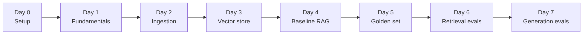
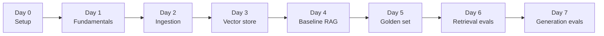
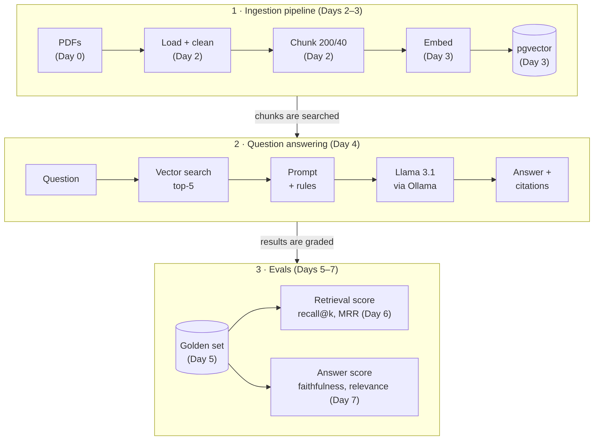
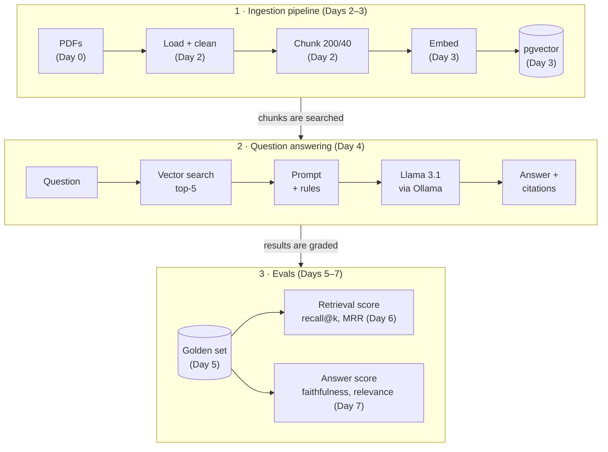
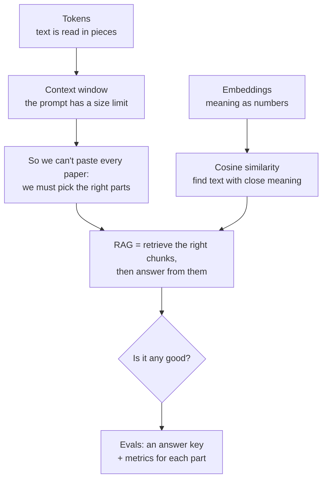

# Week 1: Build it, then learn to measure it

By the end of this week you have a working RAG pipeline that answers questions with citations, and a set of evals that tell you how good it is.

Diagram source (Mermaid)

| Day | You'll be able to say |
| --- | --- |
| 1 | "I can explain tokens, embeddings and why RAG exists." |
| 2 | "My PDFs become clean, overlapping chunks with page numbers." |
| 3 | "Every chunk is embedded and searchable in pgvector." |
| 4 | "I ask a question and get a cited answer, or 'I don't know'." |
| 5 | "I have 30+ hand-checked questions with known answers." |
| 6 | "Baseline recall@5 is X and MRR is Y." |
| 7 | "Faithfulness is Z, and I know which chunking strategy wins." |

**End-of-week checkpoint:** the README results table has a real baseline row.

## What you'll have built by Sunday

Each box shows the day you build it. Read it left to right: papers go in at the top, questions come in at the bottom, and the evals on the right grade both.

Diagram source (Mermaid)

## How the ideas build on each other

Each day's concept is what the next day needs. If something later feels confusing, go back one box.

Diagram source (Mermaid)

