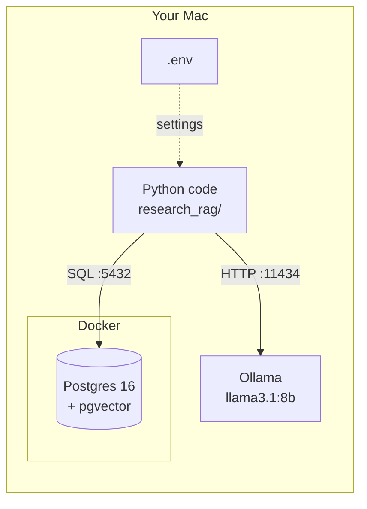

# Day 0: Setup

**Goal:** every tool is installed, the database runs, and the skeleton is committed.

## What you'll study

- How the repo is organized, and why each pipeline stage gets its own folder
- Why the LLM runs on your Mac while the database runs in Docker
- How settings flow from `.env` into the code

## Explained simply

**Why separate folders per stage?** Think of a restaurant kitchen. Prep, grill and plating are separate stations, so if the fries are bad you know exactly which station to check. When an answer is wrong, you'll want to know quickly whether ingestion, retrieval or generation caused it.

**Why `.env` and not hard-coded values?** `.env` is like the settings on your phone. The app stays the same and you change the settings. Tomorrow you might switch models or databases without touching the code.

## Diagram

Diagram source (Mermaid)

*The repo layout: product code lives in `src/research_rag/`, one folder per pipeline stage.*

## Tools and services to install

| Tool | Why | Install |
| --- | --- | --- |
| Python 3.11+ | Everything is written in Python | `brew install python@3.12` |
| Docker Desktop | Runs Postgres + pgvector | docker.com, then open the app |
| Ollama | Runs the LLM locally for free | ollama.com, then `ollama pull llama3.1:8b` |
| Git + GitHub | Version control, your public portfolio | already set up |
| VS Code (or similar) | Editor, plus Jupyter for notebooks | code.visualstudio.com |

Ollama runs natively, not in Docker, because Docker on a Mac can't use the Apple GPU. Native Ollama answers several times faster.

## What to implement

- [ ] `cp .env.example .env`
- [ ] `make install`: creates `.venv` and installs dependencies
- [ ] `make up`: starts Postgres
- [ ] `make test`: 2 tests pass
- [ ] `ollama run llama3.1:8b "Say hi in five words"`: the model answers
- [ ] Download 10–20 arXiv PDFs on one topic into `data/papers/`
- [ ] Commit and push: `Day 0: project skeleton`

**Choosing papers:** pick a topic you're curious about (for example LLM fine-tuning, or retrieval). Papers on one topic make better test questions, because some questions will need two papers to answer.

## Done when

`make test` passes, `docker ps` shows `research-rag-db` as healthy, and Ollama answers a prompt.
