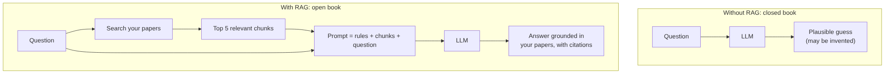
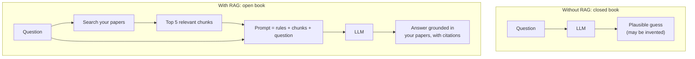

# Day 1: LLM and embedding fundamentals

**Goal:** understand just enough about LLMs and embeddings to make good RAG decisions, and be able to explain why RAG exists.

> **Finished Day 1?** Read the [Day 1 recap](RECAP.md): every concept explained in plain words, with diagrams built from your own results.

## What you'll study

- **Tokens** and **context windows**
- **Temperature** and sampling
- Why LLMs **hallucinate**
- **Embeddings** and **cosine similarity**
- How RAG fixes hallucination by putting facts in the prompt

## Explained simply

### Tokens: the LEGO bricks of text
An LLM doesn't read words; it reads **tokens**, which are chunks of words. "Unbelievable" might become `Un` + `believ` + `able`. A rough rule for English: **1 token ≈ ¾ of a word**, so 100 tokens is about 75 words.

**Why it matters:** models have a **context window**, a maximum number of tokens they can read at once (prompt + answer). Llama 3.1 supports up to 128K tokens, but Ollama uses a much smaller window by default. One research paper can be 10–20K tokens, so you can't paste 20 papers into a prompt. You have to pick the few paragraphs that matter, and that's exactly what retrieval does.

### Temperature: how adventurous the model is
At each step the model has a list of possible next tokens with probabilities, like:

| Next token after "The sky is" | Probability |
| --- | --- |
| blue | 70% |
| clear | 15% |
| falling | 1% |

- **Temperature 0:** always pick the top choice ("blue"). Predictable, so use it for RAG and evals.
- **Temperature 1:** roll weighted dice. Sometimes "clear", rarely "falling". Use it for creative writing.

### Hallucination: a confident student who didn't study
An LLM is trained to produce **plausible** text, not **true** text. Ask about a paper it never read and it will invent a convincing answer, the way a student bluffs through an exam question.

### RAG: turn the closed-book exam into an open-book exam
**Retrieval-Augmented Generation** = find the relevant pages first, put them in the prompt, then tell the model: "answer only from these pages." Same student, but now with the textbook open to the right page.

### Embeddings: GPS coordinates for meaning
An **embedding** turns text into a list of numbers (a vector) so that **similar meanings land close together**. Your model, all-MiniLM-L6-v2, outputs 384 numbers per text.

Simple example, shrunk to 2 numbers:

| Sentence | Vector |
| --- | --- |
| "The cat sat on the mat" | [0.9, 0.1] |
| "A kitten rested on the rug" | [0.85, 0.15] |
| "Quarterly revenue grew 8%" | [0.1, 0.95] |

The two cat sentences share almost no words, yet their vectors are close. **That is why vector search finds meaning, not just keywords.**

### Cosine similarity: do two arrows point the same way?
Picture each vector as an arrow from the origin. Cosine similarity measures the angle between two arrows:
- **1.0**: same direction (same meaning)
- **0**: unrelated
- Cat vs. kitten above ≈ **0.99**; cat vs. revenue ≈ **0.21**

## Diagram



<details>
<summary>Diagram source (Mermaid)</summary>



</details>

## Tools and services

| Tool | Use today |
| --- | --- |
| Ollama REST API (`http://localhost:11434`) | Call the LLM from Python |
| `httpx` | Make HTTP requests |
| `tiktoken` | Count tokens |
| `sentence-transformers` | Create embeddings |
| Jupyter (VS Code) | Run the notebook |

`tiktoken` counts tokens the way OpenAI models do. Llama's tokenizer is a little different, so treat the counts as close estimates, which is all you need for chunk sizing.

## What to implement

Create `notebooks/week-1/day-01-llm-fundamentals/01_fundamentals.ipynb`:

- [ ] Count tokens in a paragraph from one of your papers with `tiktoken.get_encoding("cl100k_base")`
- [ ] Call Ollama from Python:
  ```python
  import httpx
  r = httpx.post("http://localhost:11434/api/generate",
                 json={"model": "llama3.1:8b", "prompt": "What is LoRA?",
                       "stream": False, "options": {"temperature": 0}},
                 timeout=120)
  print(r.json()["response"])
  ```
- [ ] Ask the same question 3 times at temperature 0 and 3 times at 1. Compare the answers.
- [ ] Embed 6 sentences (2 about cats, 2 about finance, 2 about your paper topic) and print the cosine similarity matrix:
  ```python
  from sentence_transformers import SentenceTransformer, util
  model = SentenceTransformer("sentence-transformers/all-MiniLM-L6-v2")
  emb = model.encode(sentences, normalize_embeddings=True)
  print(util.cos_sim(emb, emb))
  ```
- [ ] Ask the LLM a detailed question about one of your papers **without** context. Note what it gets wrong.
- [ ] Paste the relevant paragraph into the prompt and ask again. Note the difference.

## Done when

You can explain to a non-engineer, in two minutes, why RAG exists, using your own hallucination example.

## Go deeper (optional)

- Andrej Karpathy, "Intro to Large Language Models" (YouTube, 1 hour)
