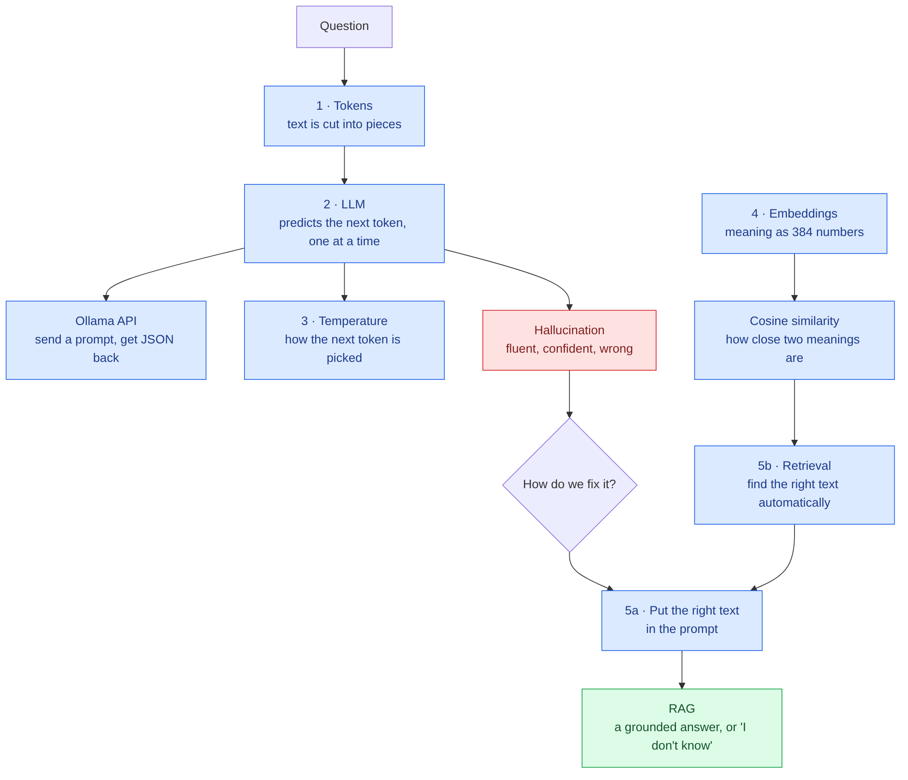
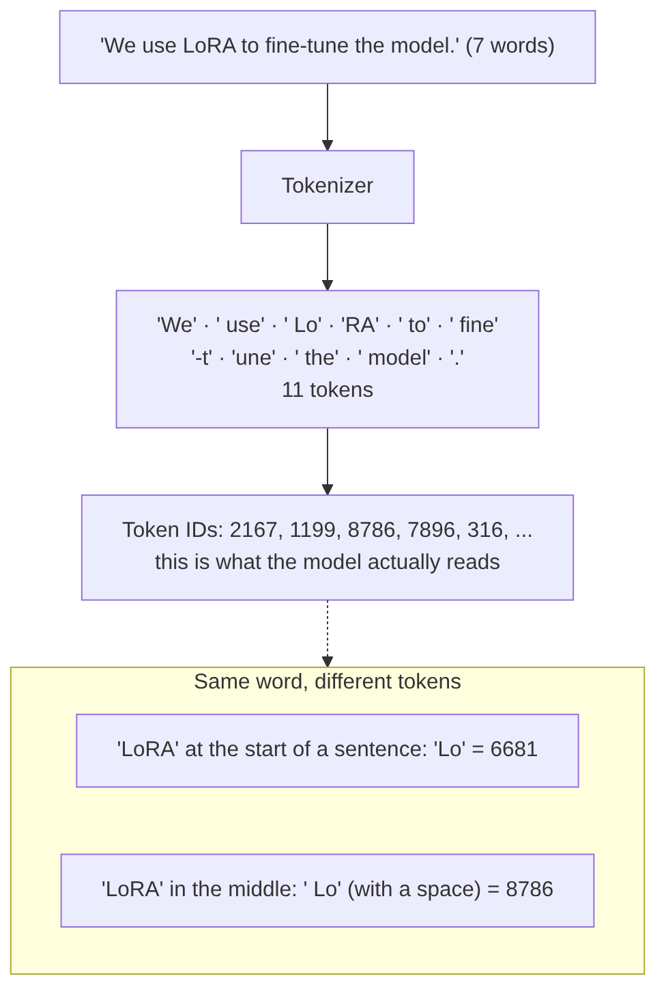
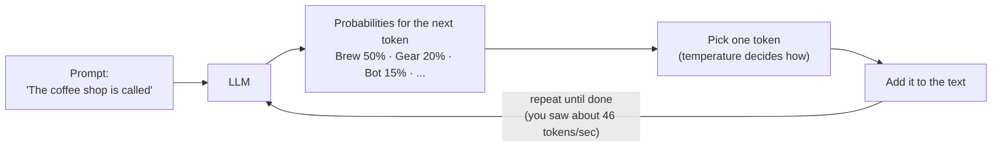
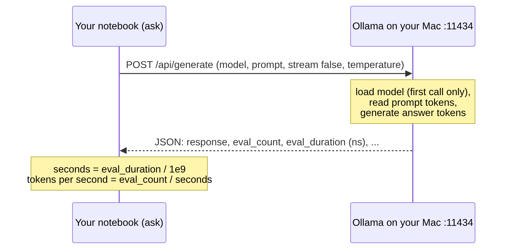
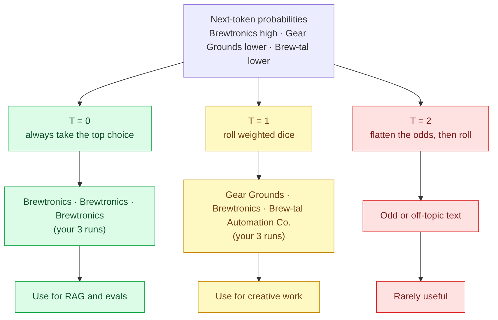
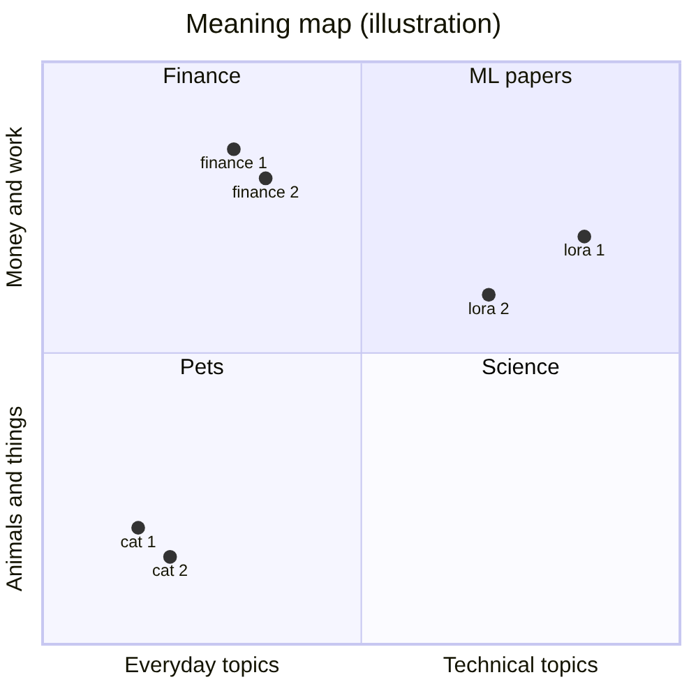
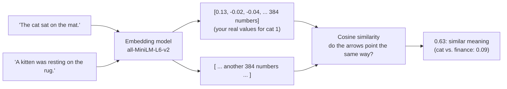
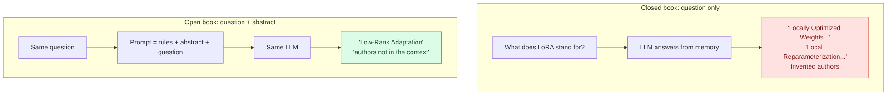
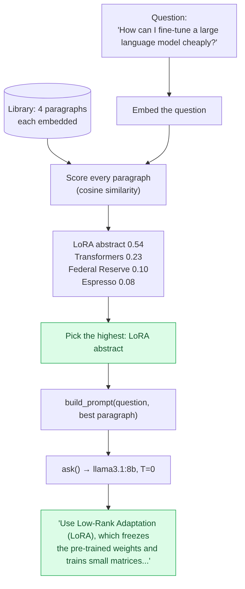

# Day 1 recap: what you learned, in plain words

Everything here comes from **your own notebook** (`notebooks/week-1/day-01-llm-fundamentals/01_fundamentals.ipynb`): your outputs, your numbers, your hallucinations.

## The big picture

Today you learned six ideas, and they connect into one story: **LLMs are powerful but make things up; RAG fixes that by finding the right text and putting it in the prompt.**

Read it top to bottom:
- **Left side:** how an LLM works (tokens → prediction → temperature), and its main weakness: hallucination.
- **Right side:** how embeddings let you *find* the right text.
- **Bottom:** the two sides meet in **RAG**.

---

## 1. Tokens: the pieces a model reads

**In one sentence:** an LLM doesn't read words; it reads **tokens**, small pieces of words, each turned into a number.

**Simple picture:** like LEGO bricks. Common words are one brick (`' the'`, `' model'`). Rare words are built from several (`'LoRA'` = `'Lo'` + `'RA'`, `'Unbelievable'` = `' Un'` + `'bel'` + `'ievable'`).

**What you saw:**
- "LoRA" became **2 tokens**.
- **Spaces stick to the next word**, so `'Lo'` at the start of a sentence (ID 6681) and `' Lo'` in the middle (ID 8786) are **different tokens** for the same letters.
- Your physics paragraph: **183 words = 249 tokens, about 0.73 words per token**. Jargon is expensive: `Schwinger--Dyson` alone cost 6 tokens.

**Why it matters:** every limit is counted in tokens: how much text fits in a prompt (the **context window**), how big a chunk is (Day 2), cost and speed. Rule of thumb: **100 tokens ≈ 75 words**.

---

## 2. The LLM: a next-token predictor

**In one sentence:** an LLM writes by **predicting the most likely next token, adding it, and repeating**, one token at a time.

**Simple picture:** a very well-read autocomplete. It has read a huge amount of text, so it's very good at guessing what usually comes next, but it's guessing **what sounds right**, not looking up **what is true**.

### Talking to it: the Ollama API

Your notebook talks to the model the same way any app talks to a web service: **send a request, get JSON back**.

**What you saw:**
- The answer is in `response`; tokens generated in `eval_count`; times in **nanoseconds** (÷ 1,000,000,000 for seconds).
- Your Mac generates about **46 tokens per second**.
- Your 7-word prompt became **18 tokens**, because Llama adds hidden markers for "user" and "assistant" turns.

**Why it matters:** every part of your RAG system will call the model through this same `ask()`-style function.

---

## 3. Temperature: how adventurous the model is

**In one sentence:** temperature controls **how the next token is picked**: always the favorite, or sometimes a less likely one.

**Simple picture:** a jar of marbles, where more marbles means a more likely word.
- **T=0:** don't draw; take the color with the most marbles.
- **T=1:** shake the jar and draw one.
- **T=2:** even out the colors first, so rare ones come up a lot.

**What you saw:** T=0 gave **"Brewtronics" 3 out of 3 times**. T=1 gave **three different names**.

**Why it matters:** use **T=0 for RAG and evals**, because answers must be repeatable. And remember: **temperature controls randomness, not accuracy.** At T=0 the model still got LoRA wrong; it was just wrong consistently.

---

## 4. Hallucination: fluent, confident and wrong

**In one sentence:** when the model doesn't know something, it **produces a plausible-sounding answer anyway**, because it's built to continue text, not to check facts.

**Simple picture:** a confident student bluffing through an exam question they didn't study for.

**What you saw:** two questions about LoRA got **two different invented answers**:

| Question | Invented answer | Truth |
| --- | --- | --- |
| "What does LoRA stand for?" | "Locally Optimized Weights for Rapid Adaptation", "You et al., 2020" | **Low-Rank Adaptation**, Hu et al., 2021 |
| "What does LoRA stand for, and who wrote it?" | "Local Reparameterization", "Edwin Chu et al." | same |

**Why it matters:** this is the problem your whole project solves. Hallucinations hide in names, numbers, dates and definitions: exactly the details people need to be right.

---

## 5. Embeddings: meaning as numbers

**In one sentence:** an embedding turns text into **384 numbers** so that **texts with similar meaning get similar numbers**, even when they use different words.

**Simple picture:** GPS coordinates for meaning. Sentences about the same thing land near each other on a "meaning map":

*(This map is a simplified 2-D illustration. The real map has 384 directions, which nobody can draw, but the idea is the same.)*

### Cosine similarity: how close two meanings are

Think of each embedding as an arrow. **Cosine similarity** checks whether two arrows point the same way: **1.0 = same meaning, about 0 = unrelated.**

**What you saw:**

| Pair | Score | Lesson |
| --- | --- | --- |
| cat ↔ kitten sentence | **0.63** | different words, same meaning: matched |
| market fell ↔ shares dropped | **0.59** | matched |
| "LoRA…" ↔ "Low-rank adaptation…" | **0.40** | weaker: the model doesn't know the acronym |
| cats ↔ finance | **0.03–0.10** | unrelated |

**Why it matters:**
- This is how your system will **find the right chunk** even when the question uses different words from the paper.
- Real paraphrase scores are about **0.5–0.8**, not near 1.0, so thresholds must come from measuring, not guessing (Day 11).
- Embeddings are **weak on acronyms and exact terms**, which is why you'll add keyword search on Day 8.
- **384** is this model's size. Your database column will be `vector(384)` (Day 3), and documents and questions must always use the **same** model.

---

## 6. RAG: answer from the right text

**In one sentence:** **Retrieval-Augmented Generation** = find the most relevant text, put it in the prompt, and tell the model to answer **only** from it.

**Simple picture:** turning a closed-book exam into an open-book exam, with a librarian who hands you the right page.

### 5a: Same question, with and without the page

With the abstract in the prompt, the model said **"Low-Rank Adaptation"** and admitted **the authors weren't in the context** instead of inventing them. That honesty came from one line in your prompt: *"If the context does not contain the answer, say I don't know."*

### 5b: Finding the page automatically

Your question said "fine-tune… **cheaply**", a word the abstract never uses, yet the LoRA abstract scored **0.54**, well ahead of everything else. Retrieval matches **meaning**, not words.

**Why it matters:** this five-step loop (**embed → score → pick → prompt → answer**) *is* your project. The next 13 days make each step production-quality:

| Today's toy version | The real version |
| --- | --- |
| 4 paragraphs in a Python list | thousands of chunks from real PDFs (Day 2) |
| `util.cos_sim` over a list | pgvector search in Postgres (Day 3) |
| pick the single best paragraph | top-5 chunks with citations (Day 4) |
| "looks right to me" | measured with a golden test set (Days 5–7) |
| embeddings only | embeddings + keyword search + reranking (Days 8–9) |

---

## Glossary

| Term | Plain meaning |
| --- | --- |
| **Token** | A piece of a word; what the model actually reads. About ¾ of a word. |
| **Context window** | The most tokens a model can read at once (prompt + answer). |
| **LLM** | A model that writes by predicting the next token, over and over. |
| **Temperature** | How randomly the next token is picked. 0 = always the favorite. |
| **Hallucination** | A confident, plausible answer that is false. |
| **Embedding** | A list of numbers (384 here) that represents a text's meaning. |
| **Dimension** | How many numbers are in an embedding. |
| **Cosine similarity** | How closely two embeddings point the same way: 1 = same, 0 = unrelated. |
| **Retrieval** | Finding the most relevant text for a question. |
| **Context** | The text you put in the prompt for the model to use. |
| **Grounding** | Making the model answer only from the provided context. |
| **RAG** | Retrieve the right text, then generate an answer from it. |

## Test yourself

Try answering these out loud, as if in an interview. The answers are all above.

1. Why can't you just paste all 20 papers into the prompt?
2. Why is "LoRA" two tokens, and why does that matter for embeddings?
3. You set temperature to 0 and the model still gives a wrong answer. Why?
4. Two sentences share no words but score 0.63. How is that possible?
5. Your RAG system answered "the authors aren't in the context." Is that a failure or a success?
6. Walk through the five steps that turned "How can I fine-tune cheaply?" into a correct, grounded answer.
