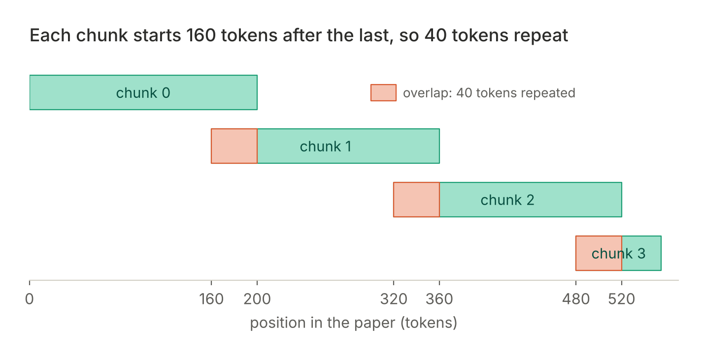
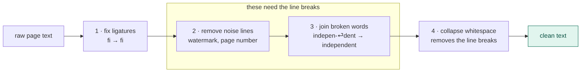
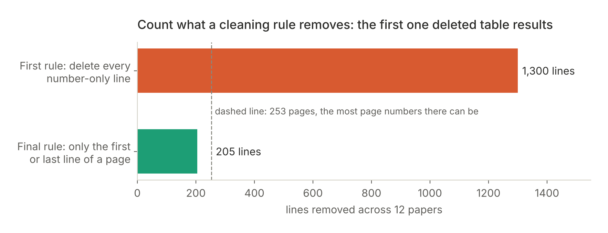
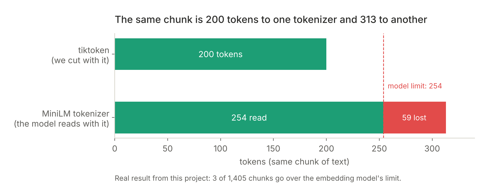
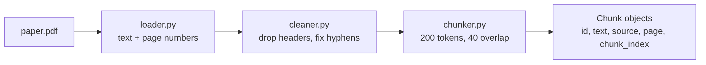
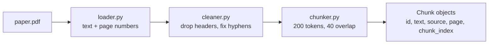
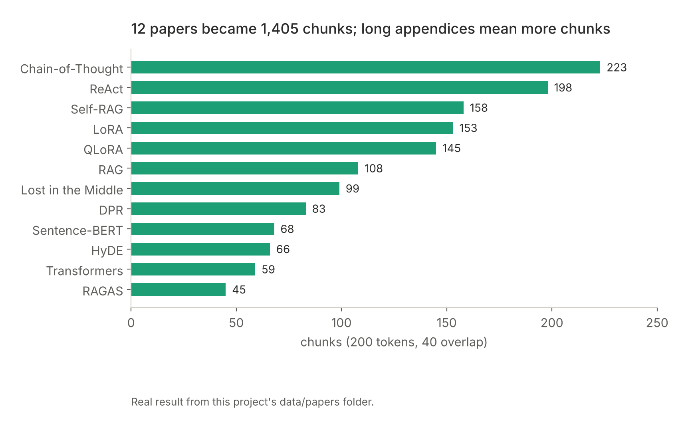

# Day 2: Ingestion and chunking

**Goal:** turn PDFs into clean, overlapping text chunks that each carry their source and page number.

## What you'll study

- PDF text extraction and its problems
- Cleaning: headers, footers, broken hyphens
- Chunking strategies and **overlap**
- **Metadata** for citations
- Unit testing a data pipeline

## Explained simply

### Why chunk at all?
Imagine making **index cards** from a textbook to study for an exam. One card per whole chapter is useless, because you can't find anything. One card per word is useless too, because there's no meaning. A card per paragraph or two is just right. Chunks are those index cards: **small enough to be specific, big enough to make sense on their own.**

### Overlap: repeating the last sentence on the next card
If a key sentence gets split between two cards, neither card makes sense alone. So each new card starts with the last few lines of the previous one.

```
Chunk 1: [ ...LoRA freezes the base model and trains | small adapter matrices ]
Chunk 2:                                             [ small adapter matrices. This cuts memory... ]
                                                       ^^^ overlap ^^^
```



*The sliding window: 200 tokens per chunk, moving forward 160 each time, so 40 tokens repeat.*

### PDFs are messier than they look
A PDF stores **where to draw letters on a page**, not paragraphs. Extraction can give you:
- Page headers like "arXiv:2106.09685v2" repeated on every page
- Words broken across lines: `optimiza-` / `tion`
- Two-column layouts read in the wrong order

Garbage in, garbage out. A chunk full of headers wastes space and confuses search.



*The order of the cleaning steps matters: rules that look at lines must run before the line breaks are removed.*



*A real lesson from this project: always count what a cleaning rule changes across the whole dataset.*

### Metadata: the card's label
Every chunk stores where it came from: `source`, `page`, `chunk_index`. Without it you can't cite "Hu et al., p. 4", and citations are what make users trust the answer.

### The chunk size trap
Your embedding model, all-MiniLM-L6-v2, **only reads the first 256 of its own tokens** and silently ignores the rest. A 400-token chunk would be cut off without any error. That's why this project uses **200 tokens with 40 overlap**. Lesson: **always check your embedding model's max input length before choosing a chunk size.**



*Each model has its own tokenizer, so a token count only means something together with the tokenizer that made it.*

## Diagram



<details>
<summary>Diagram source (Mermaid)</summary>



</details>



*What the pipeline produced for this project's 12 papers.*

## Tools and services

| Tool | Use today |
| --- | --- |
| `pymupdf` (`import fitz` or `import pymupdf`) | Extract text page by page |
| `tiktoken` | Measure chunk length in tokens |
| `pydantic` | The `Chunk` data model |
| `pytest` | Test the chunker |

## What to implement

- [ ] `src/research_rag/ingestion/models.py`: a `Chunk` Pydantic model with `id`, `text`, `source`, `page`, `chunk_index`, `token_count`
- [ ] `src/research_rag/ingestion/loader.py`: `load_pdf(path) -> list[Page]`, where each page has its number and text
- [ ] `src/research_rag/ingestion/cleaner.py`:
  - remove lines that repeat on most pages (headers/footers)
  - join hyphenated line breaks: `optimiza-\ntion` → `optimization`
  - collapse extra whitespace
- [ ] `src/research_rag/ingestion/chunker.py`: token-aware sliding window using `settings.chunk_size` and `settings.chunk_overlap`; a chunk keeps the page it **starts** on
- [ ] `src/research_rag/ingestion/run.py`: `python -m research_rag.ingestion.run` prints chunk counts per paper
- [ ] `tests/test_chunker.py`:
  - no chunk is longer than `chunk_size`
  - consecutive chunks overlap by `chunk_overlap` tokens
  - no empty chunks
  - a short text gives exactly one chunk

## Done when

Running ingestion prints counts per paper, and 5 random chunks read like clean text with the right page numbers.

## Stretch

Write a second chunker that splits on section headings ("1 Introduction", "2 Related Work"). You'll measure which one retrieves better on Day 7.

## As built (what we actually did)

```
PDF ──load_pdf──► Page(source, page_number, text)
     ──clean_text──► ligatures → control chars → noise lines → hyphen joins → whitespace
     ──chunk_pages──► Chunk(id="2106.09685.pdf::0003", page_number, text, token_count)
     ──make ingest──► data/processed/chunks.jsonl
```

| Plan | What we did | Why |
| --- | --- | --- |
| Remove page numbers anywhere | Only check a page's **first or last line** | The broad regex deleted 1,300 lines of table numbers |
| Clean text | Added `remove_control_characters` (Day 3) | PDF equation brackets come out as NUL characters, which Postgres rejects |
| Chunk IDs | `source::NNNN` (stable while chunk size stays the same) | Easy to read and debug |
| Chunk size | 200 tiktoken (`o200k_base`) tokens, 40 overlap | 3 chunks exceed MiniLM's 254-token limit; parked for Day 7 |

**Numbers:** 12 papers · 253 pages · 1,405 chunks (1,389 after Day 3's control-character fix) · 205 noise lines removed.
