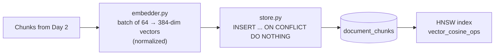
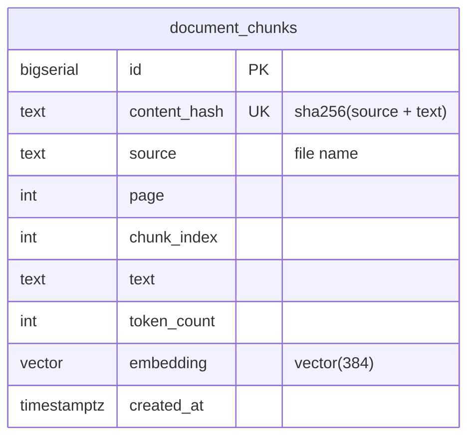

# Day 3: Embeddings and vector store

**Goal:** embed every chunk and store it in Postgres so it can be searched by meaning, and make reloading safe.

## What you'll study

- Choosing an embedding model
- Storing vectors in **pgvector**
- **Exact vs. approximate** search, and the **HNSW** index
- **Idempotent** loads
- Batching for speed

## Explained simply

### pgvector: Postgres learns a new column type
pgvector adds a `vector(384)` column type and distance operators to Postgres. You keep using SQL, joins and transactions, so it fits naturally with your data engineering background.

| Operator | Meaning |
| --- | --- |
| `<=>` | cosine **distance** (0 = identical). Similarity = `1 - distance` |
| `<->` | Euclidean distance |
| `<#>` | negative inner product |

### Exact vs. approximate search: checking every house vs. using highways
**Exact search** compares the query with every chunk. That's perfect, but slow with millions of rows, like visiting every house in a city to find your friend.

**HNSW** (Hierarchical Navigable Small World) builds a layered map: highways at the top, then main roads, then local streets. Search starts on the highway, gets close quickly, then drops down to the streets for the last stretch. It's **much faster and almost always finds the right answer** (≈95–99% of the true nearest neighbors).

With only a few thousand chunks, exact search would be fine. You add HNSW because a production system needs it and interviewers will ask about it.

### Idempotent loads: pressing the elevator button twice
Pressing an elevator button twice doesn't call two elevators. Running ingestion twice shouldn't create duplicate chunks either. The fix: give each chunk a **content hash** (a fingerprint of its text + source) with a `UNIQUE` constraint, and insert with `ON CONFLICT DO NOTHING`.

### Same model for documents and questions
Embeddings from different models live in different "maps". Embedding documents with model A and questions with model B is like using GPS coordinates from Earth on a map of Mars. Always use **one model for both**.

## Diagram


<details>
<summary>Diagram source (Mermaid)</summary>



</details>


<details>
<summary>Diagram source (Mermaid)</summary>



</details>

## Tools and services

| Tool | Use today |
| --- | --- |
| Postgres 16 + pgvector (Docker) | Store and search vectors |
| `psycopg` 3 + `pgvector` Python package | Talk to Postgres, send vectors |
| `sentence-transformers` | Embed chunks |
| `hashlib` | Content hashes |
| `psql` or a GUI like TablePlus/DBeaver | Inspect the table |

## What to implement

- [ ] Add the table and index to `db/init.sql`, then `make reset`:
  ```sql
  CREATE TABLE IF NOT EXISTS document_chunks (
      id            BIGSERIAL PRIMARY KEY,
      content_hash  TEXT UNIQUE NOT NULL,
      source        TEXT NOT NULL,
      page          INT  NOT NULL,
      chunk_index   INT  NOT NULL,
      text          TEXT NOT NULL,
      token_count   INT  NOT NULL,
      embedding     vector(384) NOT NULL,
      created_at    TIMESTAMPTZ DEFAULT now()
  );
  CREATE INDEX IF NOT EXISTS document_chunks_embedding_hnsw
      ON document_chunks USING hnsw (embedding vector_cosine_ops);
  ```
- [ ] `research_rag/embeddings/embedder.py`: load the model once, `embed(texts) -> np.ndarray`, batch size 64, `normalize_embeddings=True`
- [ ] `research_rag/embeddings/store.py`: open a connection, `register_vector(conn)`, bulk insert with `ON CONFLICT (content_hash) DO NOTHING`
- [ ] Extend `ingestion/run.py`: load → clean → chunk → embed → store
- [ ] Sanity query in `psql`: the 3 chunks closest to the first chunk's embedding should be from the same paper
- [ ] `tests/test_store.py`: inserting the same chunks twice leaves the row count unchanged

## Done when

`make up` plus one ingestion command fills the table, and running it again doesn't change `SELECT count(*) FROM document_chunks`.
