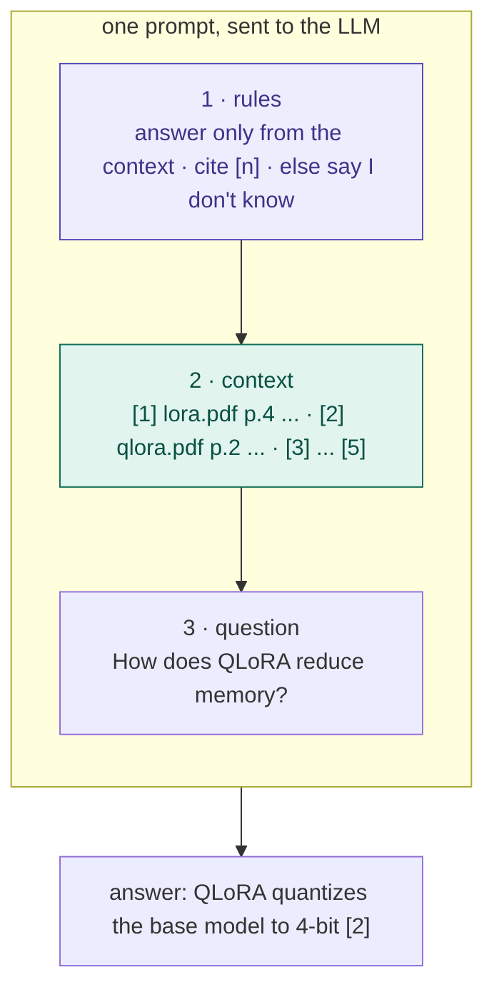
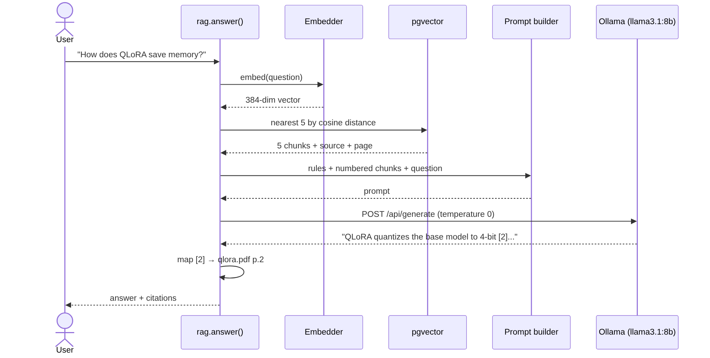
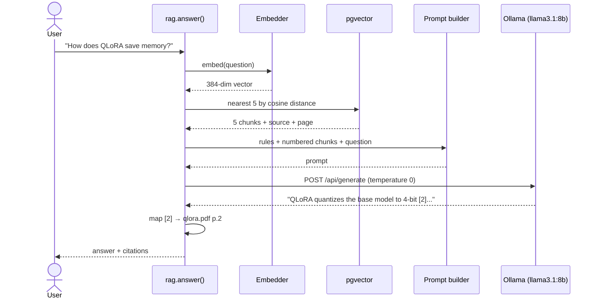

# Day 4: Baseline RAG with citations

**Goal:** connect everything end to end. A question goes in, and an answer with citations comes out, or "I don't know" when the papers don't cover it.

## What you'll study

- **Top-k** retrieval
- Prompt structure for RAG
- **Grounding**: answering only from context
- **Citations**: mapping `[1]` back to a paper and page
- Why this version is called the **baseline**

## Explained simply

### Top-k: how many index cards to hand the model
Retrieval returns the **k** closest chunks.
- **k too small (1–2):** you might miss the card with the answer.
- **k too large (20):** the answer is in there, buried under noise, and the prompt gets long and slow.

Start with **k = 5**. On Day 6 you'll measure whether that's right.

### The RAG prompt: a briefing for a careful assistant
Think of briefing an assistant before a meeting: "Here are 5 documents. Answer only from them. Say which document each fact came from. If they don't cover it, say you don't know."

```text
SYSTEM:
You answer questions using ONLY the numbered context below.
Cite sources inline like [1] or [2][3].
If the context does not contain the answer, reply exactly: "I don't know based on the provided papers."

CONTEXT:
[1] (lora.pdf, p.4) LoRA freezes the pretrained weights and injects trainable rank-decomposition matrices...
[2] (qlora.pdf, p.2) QLoRA backpropagates through a frozen 4-bit quantized model into LoRA adapters...
...

QUESTION:
How does QLoRA reduce memory compared to LoRA?
```



*The three parts of a RAG prompt, in order.*

### Citations: footnotes you can check
The model writes `[2]`. Your code knows `[2]` = `qlora.pdf, page 2`, so the API returns a clickable source. **Citations turn "trust me" into "check me."**

![How a `[2]` in the answer becomes a clickable source.](fig-citations.png)

*How a `[2]` in the answer becomes a clickable source.*

### Baseline: the "before" photo
This first version is deliberately simple. It's the "before" photo for every later improvement. Don't optimize yet; get it working and measured.

## Diagram



<details>
<summary>Diagram source (Mermaid)</summary>



</details>

## Tools and services

| Tool | Use today |
| --- | --- |
| pgvector `<=>` | Similarity search |
| Ollama `/api/generate` | Generation |
| `httpx` | HTTP client with a timeout |
| `argparse` or `typer` | A small command-line interface |

## What to implement

- [ ] `src/research_rag/retrieval/search.py`: `search(query, k=5) -> list[RetrievedChunk]` (chunk + similarity score):
  ```sql
  SELECT id, source, page, text, 1 - (embedding <=> %s) AS score
  FROM document_chunks
  ORDER BY embedding <=> %s
  LIMIT %s;
  ```
- [ ] `src/research_rag/generation/prompts.py`: one prompt template with a version string, e.g. `PROMPT_VERSION = "v1"`. Keep prompts out of your logic so you can change and compare them.
- [ ] `src/research_rag/generation/llm.py`: `generate(prompt, temperature=0) -> str`, calling Ollama with a timeout and one retry
- [ ] `src/research_rag/generation/citations.py`: find `[n]` in the answer and map it to the chunk's source and page; drop numbers that don't exist
- [ ] `src/research_rag/rag.py`: `answer(question) -> Answer` with `text`, `citations`, `chunks`, `prompt_version`, `latency_ms`
- [ ] A CLI: `python -m research_rag.rag "What is LoRA?"` prints the answer and its sources

## Done when

- 5 questions you write get answers that cite the correct paper
- 1 question your papers can't answer (e.g. "What's the capital of France?") gets "I don't know..."

## Common problems

| Symptom | Likely cause |
| --- | --- |
| Right answer, wrong citation number | The model miscounted; put the number at the start of each chunk, as above |
| Answers ignore the context | Temperature isn't 0, or the rules are buried; put them first |
| Very slow first call | Ollama loads the model on first use; later calls are faster |
