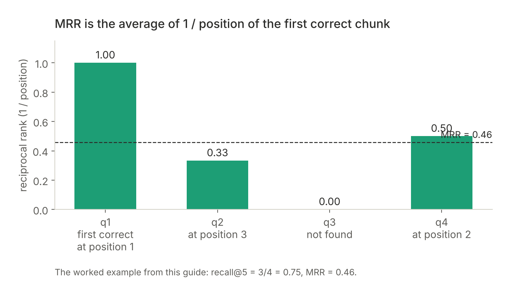
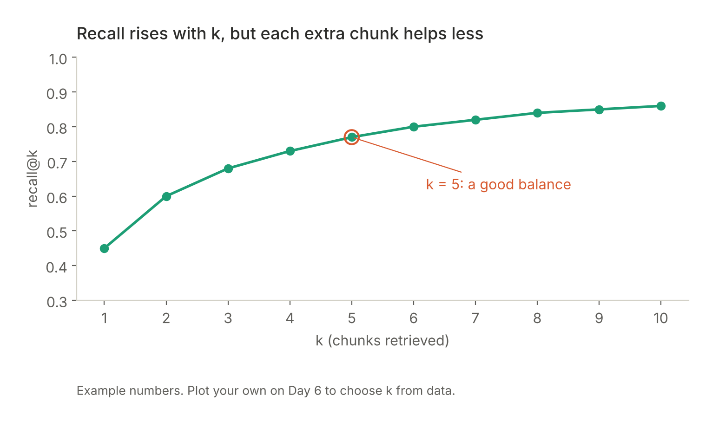
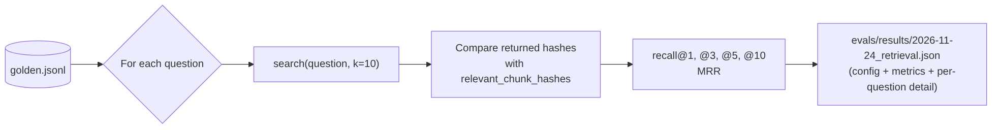
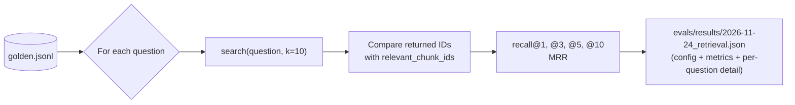

# Day 6: Retrieval evals

**Goal:** measure how well retrieval finds the right chunks, and record your first real numbers.

## What you'll study

- Why you evaluate **retrieval and generation separately**
- **Recall@k**
- **MRR** (Mean Reciprocal Rank)
- Choosing **k** from data
- Making eval runs **reproducible**

## Explained simply

### Evaluate the librarian and the writer separately
RAG has two jobs: a **librarian** (retrieval) finds the pages and a **writer** (the LLM) answers from them. If an answer is wrong, you need to know who failed. If the librarian never brought the right page, no writer can fix it. Today you grade the librarian.

### Recall@k: did the right page show up at all?
For each question: were any of the correct chunks in the top k results? Recall@5 is the share of questions where the answer was in the top 5.

### MRR: how high did it show up?
For each question, find the position of the **first** correct chunk and take 1 ÷ position. Average over all questions.

**Worked example** with 4 questions and k = 5:

| Question | Position of first correct chunk | Found in top 5? | 1 / position |
| --- | --- | --- | --- |
| q1 | 1 | yes | 1.00 |
| q2 | 3 | yes | 0.33 |
| q3 | not found | no | 0 |
| q4 | 2 | yes | 0.50 |

- **Recall@5** = 3 found ÷ 4 = **0.75**
- **MRR** = (1.00 + 0.33 + 0 + 0.50) ÷ 4 = **0.46**

Recall tells you whether the answer is reachable. MRR tells you whether it's near the top, which matters because LLMs pay most attention to the first chunks in the prompt.

Skip unanswerable questions for these metrics; there's no correct chunk to find. You'll score them on Day 7.



*The worked example as a chart: each bar is one question's reciprocal rank.*



*Plot recall@k for k = 1 to 10 to choose k from data instead of guessing.*

## Diagram



<details>
<summary>Diagram source (Mermaid)</summary>



</details>

## Tools and services

| Tool | Use today |
| --- | --- |
| Plain Python | The metrics are about 20 lines; write them yourself to understand them |
| `pandas` (optional) | Look at per-question results |
| Git | Results files are committed, so history shows progress |

## What to implement

- [ ] `src/research_rag/evals/metrics.py`: `recall_at_k(retrieved, relevant, k)` and `reciprocal_rank(retrieved, relevant)`
- [ ] `tests/test_metrics.py`: reproduce the worked example above exactly
- [ ] `src/research_rag/evals/retrieval_eval.py`:
  - run `search(q, k=10)` for each answerable question
  - compute recall@1, 3, 5, 10 and MRR
  - save a dated JSON file with the **config** (model, chunk size, overlap, k) **and** per-question results
- [ ] `python -m research_rag.evals.retrieval_eval` prints a summary table
- [ ] Look at the 5 worst questions. For each, write one line in `notebooks/LEARNINGS.md` about why it failed (bad chunking? acronym? answer split across chunks?)
- [ ] Put the baseline numbers in the README results table

## Done when

You can say: "Baseline recall@5 is X and MRR is Y, and the main failure pattern is Z."

## As built (what we actually did)

```
golden.jsonl (10 answerable) ─► search(q, k=10) ─► compare with relevant_chunk_ids
        ─► recall@1/3/5/10 + MRR ─► evals/results/2026-11-25_retrieval.json (config + per question)
```

| Plan | What we did | Why |
| --- | --- | --- |
| Compare content hashes | Compare chunk IDs | Labels use chunk IDs (Day 5) |
| Eval results committed | Removed `evals/results/` from `.gitignore` | So git history shows the scores over time |
| Recall@1/3/5/10 | Plus a recall@k curve for every k from 1 to 10, from the saved top-10 IDs | See exactly where the curve flattens |
| Look at the worst questions | Found that **half of the first-run misses were labelling misses**, fixed them with `find_chunks`, re-ran | Always audit misses before trusting a score |

"Recall@k" here means a hit if **any** labelled chunk is in the top k (sometimes called hit rate).

**Results (vector search, MiniLM, 200/40 chunks):**

| | First run (bad labels) | Baseline (labels fixed) |
| --- | --- | --- |
| recall@1 | 0.00 | 0.30 |
| recall@3 | 0.10 | 0.50 |
| recall@5 | 0.20 | **0.50** |
| recall@10 | 0.40 | 0.60 |
| MRR | 0.08 | **0.39** |

**Failure pattern:** junk chunks (tables, references, formulas) in 5 of 6 misses; acronyms and exact numbers (RAGAS, HyDE, 65.2%) in 3. The right paper is #1 for 9/10 questions.

**k:** recall is flat from k=3 to k=8, so keep k=5; 40% of answers aren't in the top 10, so improve retrieval rather than raising k.

Note: `diagram-1.png` above still says "hashes"; the Mermaid source below it is correct.
