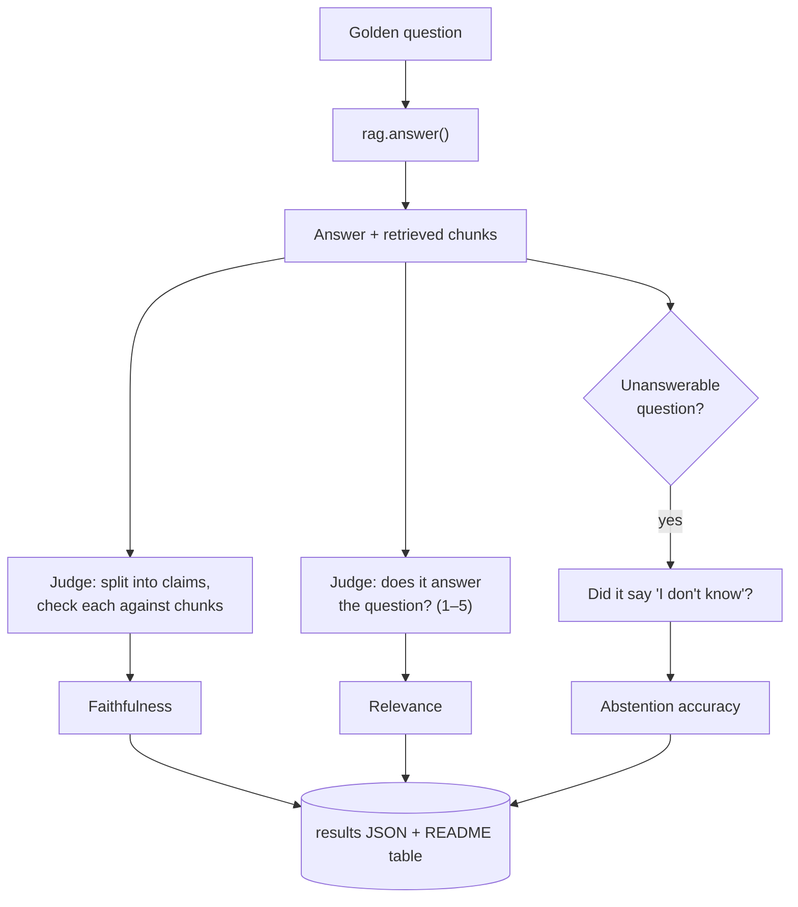

# Day 7: Generation evals and your first experiment

**Goal:** measure answer quality, then run your first real experiment: which chunking strategy wins?

## What you'll study

- **Faithfulness**: is every claim backed by the context?
- **Answer relevance**: does it actually answer the question?
- **LLM-as-judge** and its weaknesses
- Scoring "I don't know" on unanswerable questions
- Running an **A/B experiment**

## Explained simply

### Faithfulness: the fact-checker
Break the answer into separate claims and check each one against the retrieved chunks.

> **Answer:** "QLoRA uses 4-bit NF4 quantization [2] and was trained on 1,000 GPUs."
>
> - Claim 1: "uses 4-bit NF4 quantization" → found in chunk [2] ✅
> - Claim 2: "trained on 1,000 GPUs" → not in any chunk ❌
>
> **Faithfulness = 1/2 = 0.5**

Low faithfulness means the model is **adding things** that aren't in your papers. That's hallucination, even when retrieval worked.

### Answer relevance: did it answer what was asked?
Q: "How much memory does QLoRA save?" A: "QLoRA was published in 2023 by Dettmers et al. [2]" is faithful (true and cited) but **doesn't answer the question**.

### LLM-as-judge: a teaching assistant grading essays
Checking hundreds of claims by hand is slow, so you ask an LLM to grade, with a strict rubric. It's useful but imperfect:
- Judges favor longer answers
- A small local model is a weaker judge than a large one
- **Fix:** grade 10 answers yourself and check that the judge agrees with you on most of them

### An experiment: change one thing, measure everything
Run the full eval with fixed-size chunks, then again with section-based chunks (Day 2 stretch). Same questions, same model, same k. **Only one variable changes.** The numbers decide, not your intuition.

## Diagram

Diagram source (Mermaid)

## Tools and services

| Tool | Use today |
| --- | --- |
| Ollama (llama3.1:8b) as judge | Free, local grading |
| Ragas (optional) | Ready-made faithfulness and relevance metrics. Its API changes often, so follow the docs for the version you install and configure it to use Ollama. |
| Your own judge prompt | Recommended first: about 40 lines, and you'll understand every part |

## What to implement

- [ ] `src/research_rag/evals/judge.py`: two prompts that return JSON:
  - faithfulness: `{"claims": [{"claim": "...", "supported": true}], "score": 0.5}`
  - relevance: `{"score": 1-5, "reason": "..."}`
- [ ] Parse the JSON defensively: if the judge returns broken JSON, retry once, then mark the item `judge_error` (never crash the run)
- [ ] `src/research_rag/evals/generation_eval.py`: run `rag.answer()` on every question and compute faithfulness, relevance and **abstention accuracy** (share of unanswerable questions answered "I don't know")
- [ ] `src/research_rag/evals/run.py`: one command runs retrieval + generation evals and writes one results file
- [ ] Hand-grade 10 answers and record how often the judge agreed with you
- [ ] **Experiment:** fixed vs. section chunking. Add both rows to the README table and keep the winner.

## Done when

The README table has baseline recall@5, MRR, faithfulness, relevance and abstention accuracy, and you've picked a chunking strategy using numbers.

## Week 1 checkpoint

Commit, push, and reread your `LEARNINGS.md`. You now have the core of a portfolio project that most applicants don't: a RAG system with measurements.
