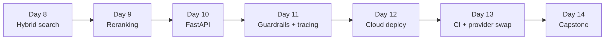
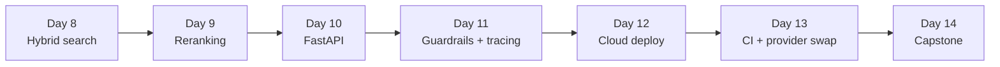
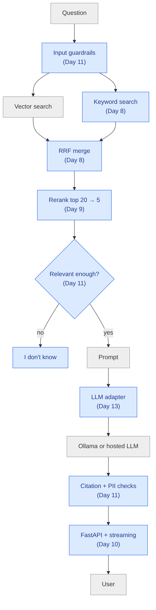
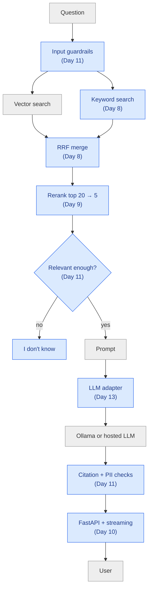
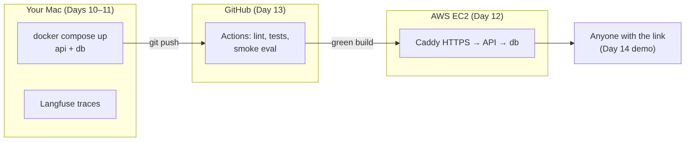
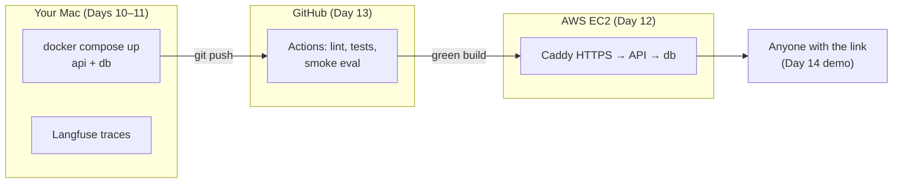

# Week 2: Make it better, then make it real

Week 1 gave you a working, measured system. Week 2 improves retrieval with techniques production teams use, turns the script into a service, and puts it online.

Diagram source (Mermaid)

| Day | You'll be able to say |
| --- | --- |
| 8 | "Hybrid search fixed acronym questions; recall@5 went from X to Y." |
| 9 | "A cross-encoder reranker raised MRR, at a cost of N ms per query." |
| 10 | "It's a FastAPI service with streaming, running with one command." |
| 11 | "It refuses out-of-scope questions, resists prompt injection, and every request is traced." |
| 12 | "It's live on AWS." |
| 13 | "Every push runs tests and a quick eval in CI." |
| 14 | "Here's the README, the demo, and what I learned." |

**Rule for this week:** every retrieval change (Days 8–9) must show up as a new row in the README results table.

## What changes this week

Gray boxes were built in Week 1. Colored boxes are new this week.

Diagram source (Mermaid)

## From laptop to live

Diagram source (Mermaid)

