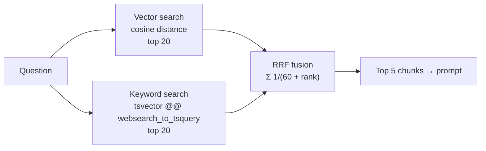

# Day 8: Hybrid search

**Goal:** combine vector search with keyword search so the system handles exact terms, acronyms and names, and prove it with your evals.

## What you'll study

- Where vector search fails
- **Keyword search** with Postgres full-text search (BM25-style ranking)
- **Reciprocal Rank Fusion (RRF)** to merge two result lists
- Running a config-flag experiment

## Explained simply

### Two kinds of librarians
- The **meaning librarian** (vector search) understands that "shrink the model's memory" and "reduce GPU footprint" mean the same thing. But ask about "NF4" and they shrug: it's a rare token without much meaning to embed.
- The **keyword librarian** (full-text search) can't handle synonyms, but finds every page that literally contains "NF4" instantly.

Hybrid search asks both and combines their lists.

| Query | Vector search | Keyword search |
| --- | --- | --- |
| "ways to cut memory during fine-tuning" | ✅ great | ❌ misses synonyms |
| "What is NF4?" | ❌ often misses | ✅ exact match |
| "LoRA rank r=8 results" | ⚠️ so-so | ✅ finds "r=8" |

### Reciprocal Rank Fusion: combining two ranked lists
Each list gives a chunk points based on its **position**, not its raw score, because the two searches use incompatible scoring scales:

**score(chunk) = Σ 1 / (60 + rank)**

The 60 is a standard constant that keeps the top spot from dominating.

**Worked example:**

| Chunk | Vector rank | Keyword rank | RRF score |
| --- | --- | --- | --- |
| A | 1 | — | 1/61 = 0.0164 |
| B | 3 | 1 | 1/63 + 1/61 = **0.0323** |
| C | 2 | 4 | 1/62 + 1/64 = 0.0318 |
| D | — | 2 | 1/62 = 0.0161 |

Final order: **B, C, A, D**. Chunk B wins because **both** librarians liked it.

## Diagram


<details>
<summary>Diagram source (Mermaid)</summary>



</details>

## Tools and services

| Tool | Use today |
| --- | --- |
| Postgres full-text search (`tsvector`, `GIN` index, `ts_rank_cd`) | Keyword search, no new service needed |
| `websearch_to_tsquery` | Parses user text safely (quotes, OR, -minus) |
| Your eval runner | Compare configs |

Postgres full-text ranking isn't exactly BM25, but it plays the same role. If you want true BM25 later, look at the ParadeDB `pg_search` extension or OpenSearch. Mention that tradeoff in interviews.

## What to implement

- [ ] Add a generated column and an index in `db/init.sql`, then `make reset` and re-ingest:
  ```sql
  ALTER TABLE document_chunks
    ADD COLUMN IF NOT EXISTS text_search tsvector
    GENERATED ALWAYS AS (to_tsvector('english', text)) STORED;
  CREATE INDEX IF NOT EXISTS document_chunks_text_search_gin
    ON document_chunks USING gin (text_search);
  ```
- [ ] `src/research_rag/retrieval/keyword.py`:
  ```sql
  SELECT id, source, page, text,
         ts_rank_cd(text_search, websearch_to_tsquery('english', %s)) AS score
  FROM document_chunks
  WHERE text_search @@ websearch_to_tsquery('english', %s)
  ORDER BY score DESC
  LIMIT %s;
  ```
- [ ] `src/research_rag/retrieval/hybrid.py`: `rrf_merge(lists, k_const=60)` and `hybrid_search(query, k=5, candidates=20)`
- [ ] `tests/test_rrf.py`: reproduce the worked example (order B, C, A, D)
- [ ] Add `RETRIEVAL_MODE=vector|hybrid` to settings and use it in `rag.py` and the eval runner
- [ ] Run evals in both modes. Add a README row. Compare results for the "exact term" question type.

## Done when

The README shows vector vs. hybrid numbers, and you can explain which question types improved and why.
