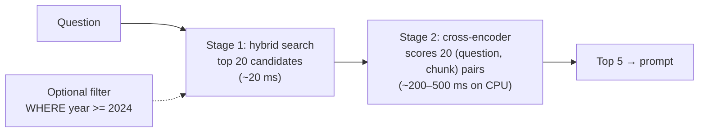

# Day 9: Reranking and metadata filtering

**Goal:** add a second-stage reranker that reorders candidates more accurately, add metadata filters, and measure the quality vs. speed tradeoff.

## What you'll study

- **Bi-encoders vs. cross-encoders**
- **Two-stage retrieval**: retrieve many cheaply, rerank a few carefully
- **Latency** budgets
- **Metadata filtering** ("only papers from 2024")

## Explained simply

### Hiring: resume screen, then interview
- **Stage 1, resume screen (bi-encoder):** you skim 1,000 resumes in an hour. Fast, but shallow. That's your embedding search: question and chunk are embedded **separately** and compared as vectors.
- **Stage 2, interview (cross-encoder):** you talk to the top 20 candidates in depth. Slow, but accurate. A cross-encoder reads the question **and** the chunk **together** and scores how well that chunk answers that question.

You'd never interview all 1,000. That's why you rerank only the top 20.

| | Bi-encoder (embeddings) | Cross-encoder (reranker) |
| --- | --- | --- |
| Reads | question and chunk separately | question and chunk together |
| Speed | very fast; chunk vectors precomputed | slow; one model run per pair |
| Accuracy | good | better |
| Used for | searching thousands of chunks | reordering the top 20 |

### Example of what reranking fixes
Question: "Does LoRA increase inference latency?"
- Embedding search ranks a chunk about **training** latency first, because it shares many words.
- The cross-encoder sees that the question is about **inference** and moves the chunk saying "no additional inference latency" to the top.

### Metadata filtering: narrowing the shelf first
"What did 2024 papers say about quantization?" There's no need to search 2021 papers at all. Filter with SQL `WHERE`, then search. Your data engineering skills apply directly here.

## Diagram


<details>
<summary>Diagram source (Mermaid)</summary>



</details>

The timings are rough CPU estimates. Measure your own.

## Tools and services

| Tool | Use today |
| --- | --- |
| `sentence_transformers.CrossEncoder` | Run the reranker |
| `cross-encoder/ms-marco-MiniLM-L-6-v2` | Small, fast reranker model (downloads on first use) |
| `time.perf_counter()` | Measure latency |

## What to implement

- [ ] `src/research_rag/retrieval/rerank.py`:
  ```python
  from sentence_transformers import CrossEncoder
  _model = CrossEncoder("cross-encoder/ms-marco-MiniLM-L-6-v2")

  def rerank(query, chunks, top_n=5):
      pairs = [(query, chunk.text) for chunk in chunks]
      scores = _model.predict(pairs)

      scored = []
      for chunk, score in zip(chunks, scores):
          scored.append((score, chunk.id, chunk))  # id breaks ties
      scored.sort(reverse=True)  # highest score first

      top = []
      for score, chunk_id, chunk in scored[:top_n]:
          top.append(chunk)
      return top
  ```
- [ ] Add `RERANK=true|false` and `RERANK_CANDIDATES=20` to settings
- [ ] Record **latency per stage** (embed, search, rerank, generate) in every `Answer`
- [ ] Add `title`, `year` and `authors` columns to `document_chunks`, filled at ingestion from the PDF metadata or a small `papers.csv`
- [ ] `search(..., filters={"year_gte": 2024})` adds a parameterized `WHERE` clause (never string-concatenate user input into SQL)
- [ ] Run evals for **vector / hybrid / hybrid + rerank**. Add retrieval metrics **and** p50 latency to the README table.

## Done when

The README table shows all three configs with quality and latency, and you've chosen a default with a one-sentence justification.
