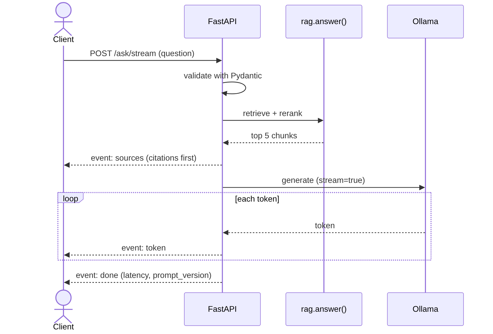
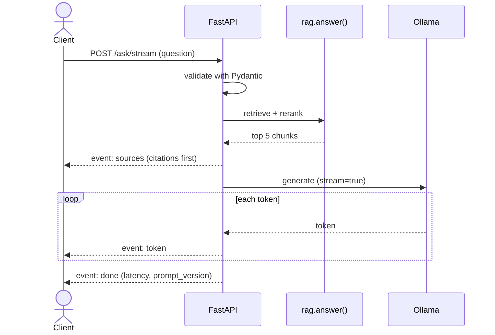
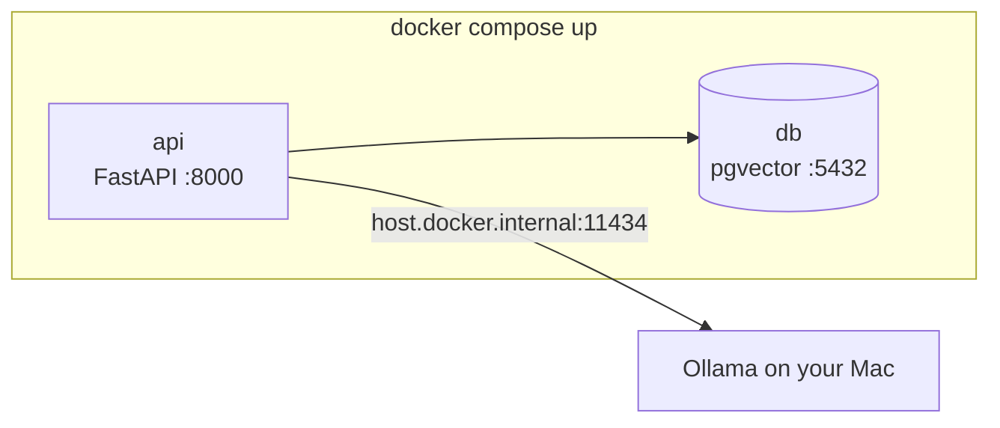

# Day 10: FastAPI service

**Goal:** turn the Python functions into a web service anyone could call, with streaming answers, and run it all with one `make up`.

## What you'll study

- REST endpoint design for an AI service
- **Pydantic** request/response models
- **Async** endpoints, and when they matter
- **Streaming** with server-sent events (SSE)
- Loading models **once** at startup
- Containerizing the API

## Explained simply

### An API is a restaurant waiter
The kitchen (your RAG code) does the work. The waiter (the API) takes orders in a standard format, brings back results, and politely refuses orders that don't make sense ("422: question is required"). Customers never walk into the kitchen.

### Pydantic models: the order form
The order form says "question: text, required, max 1,000 characters; top_k: number from 1 to 20." FastAPI checks every request against it automatically and writes the API docs for you at `/docs`.

### Streaming: watching someone type
Without streaming, the user stares at a spinner for 8 seconds and then the whole answer appears. With streaming, words appear as they're generated, like watching someone type. **Total time is the same, but it feels much faster.** The key number is **time to first token**.

### Load models once
Loading the embedding model and reranker takes seconds. Doing it on every request is like a waiter preheating the oven for every order. Load them once when the app starts (FastAPI's `lifespan`), then reuse them.

## Diagram



<details>
<summary>Diagram source (Mermaid)</summary>



</details>


<details>
<summary>Diagram source (Mermaid)</summary>



</details>

## Tools and services

| Tool | Use today |
| --- | --- |
| FastAPI + Uvicorn | The web framework and server |
| `sse-starlette` (or FastAPI's `StreamingResponse`) | Server-sent events |
| `httpx` `TestClient` / `pytest` | Endpoint tests |
| Docker (new `Dockerfile`) | Containerize the API |
| `curl` / the `/docs` page | Manual testing |

## What to implement

- [ ] `src/research_rag/api/schemas.py`: `AskRequest` (question, top_k, filters) and `AskResponse` (answer, citations, latency_ms, prompt_version)
- [ ] `src/research_rag/api/main.py`:
  - `GET /health`: checks the database **and** Ollama, returns 503 if either is down
  - `POST /ask`: the full answer as JSON
  - `POST /ask/stream`: SSE events `sources` → `token`… → `done`
  - `POST /ingest`: re-run ingestion for `data/papers/` (it's idempotent, so safe to repeat)
  - load the models in `lifespan`
- [ ] `Dockerfile`: `python:3.12-slim`, copy `pyproject.toml` and `src/`, install the package, run `uvicorn research_rag.api.main:app --host 0.0.0.0 --port 8000`
- [ ] Add an `api` service to `docker-compose.yml` with `OLLAMA_BASE_URL=http://host.docker.internal:11434` and `depends_on: db: condition: service_healthy`
- [ ] `tests/test_api.py`: health, input validation (empty question → 422), and `/ask` with retrieval and the LLM mocked
- [ ] Try it:
  ```bash
  curl -N -X POST localhost:8000/ask/stream -H 'content-type: application/json' \
       -d '{"question": "What is LoRA?"}'
  ```

## Done when

`make up` starts the database and API, `/docs` shows every endpoint, and streaming works with `curl -N`.
