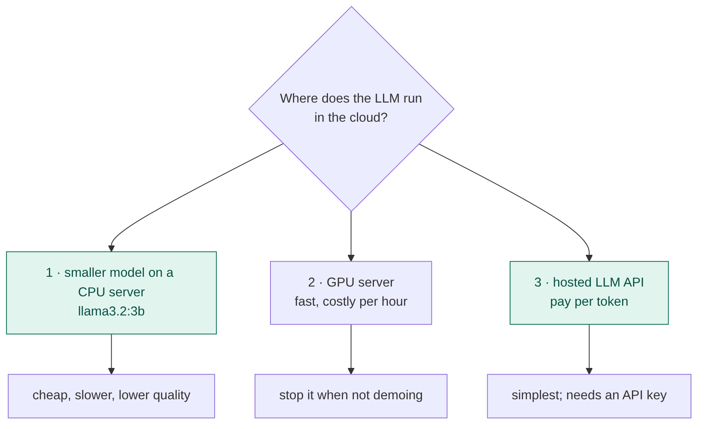
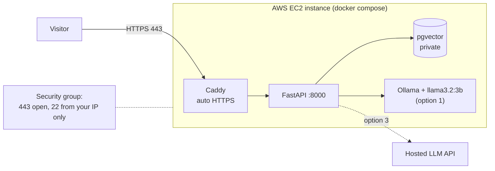

# Day 12: Cloud deploy

**Goal:** get the service running on AWS so anyone with the link can try it.

## What you'll study

- The **LLM-in-the-cloud problem**: GPUs are expensive
- Deployment options and their tradeoffs
- **Secrets** and environment configuration
- Basic **security**: ports, HTTPS, rate limiting
- **Cost control**

## Explained simply

### Moving from your kitchen to a food truck
At home you have a big oven (your Mac's GPU running llama3.1:8b). The food truck (a cheap cloud server) has a small one. You have three options:
1. **Cook smaller dishes:** run a smaller model (`llama3.2:3b`) on a CPU server. Cheap, but slower and lower quality.
2. **Rent a big oven:** a GPU server. Fast, but costs much more per hour, so stop it when you're not using it.
3. **Order from a supplier:** call a hosted LLM API for generation and keep everything else on your server. Simple and fast, but you pay per token and need an API key.

For a portfolio demo, **option 3 or option 1** is usually right. Your code already supports this if the LLM call goes through one `generate()` function (you'll formalize that tomorrow).

*The three ways to run the LLM in the cloud. Green = the usual picks for a portfolio demo.*

### Secrets: keys never go in git
API keys and database passwords go in environment variables on the server or in AWS Secrets Manager, **never** in the repo. A leaked key on GitHub can be found by bots within minutes.

### Close every door you don't use
Your server should expose **only** HTTPS (443) and SSH from your own IP. The database port (5432) stays private. Add a simple rate limit so one visitor can't run up your bill.

## Diagram

Diagram source (Mermaid)

## Tools and services

| Tool / service | Why |
| --- | --- |
| AWS account + **EC2** | One VM running Docker Compose: the simplest real deployment. Pick an instance with at least 8 GB RAM if you run Ollama on it. |
| **Elastic IP** + a domain (optional) | A stable address |
| **Caddy** | Reverse proxy with automatic HTTPS certificates |
| AWS **Budgets** | An email alert before you overspend: set this up first |
| (Optional) ECS / App Runner | Managed alternatives; more AWS practice, more setup |

Check current EC2 pricing for your region before you launch, and stop the instance when you're not demoing.

## What to implement

- [ ] Create an AWS budget alert (for example $10/month) **before** launching anything
- [ ] Launch EC2 (Ubuntu), install Docker, clone the repo
- [ ] `docker-compose.prod.yml`: adds Caddy, removes the public database port, sets `restart: unless-stopped`
- [ ] `Caddyfile` proxying your domain (or the public IP) to `api:8000`
- [ ] Choose the LLM option and set `LLM_MODEL` / provider settings in the server's `.env`
- [ ] Ingest your papers on the server and confirm `/health` returns 200
- [ ] Add a basic rate limit (e.g. `slowapi`: 10 requests/minute per IP)
- [ ] Document the deploy steps in `docs/DEPLOY.md`
- [ ] Re-run a 10-question eval against the deployed URL and note any quality change from the smaller model

## Done when

You can open the public URL on your phone, ask a question, and get a cited answer.
