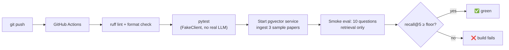
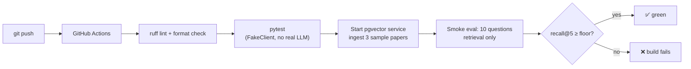

# Day 13: CI and a swappable LLM provider

**Goal:** every push automatically runs lint, tests and a small eval, and the LLM provider can be switched with one setting.

## What you'll study

- **Continuous integration** (CI) with GitHub Actions
- Running **Postgres in CI** with service containers
- **Fast vs. full** eval suites
- The **adapter pattern** for LLM providers
- **Mocking** the LLM in tests

## Explained simply

### CI is a smoke detector for your code
You don't check every room for fire each morning; a smoke detector does it automatically. CI checks every push: does it lint, do the tests pass, did quality drop? You find out in minutes, not when a hiring manager tries your demo.

### Fast and full evals
A full eval (50 questions, judged by an LLM) takes a while and needs a model. In CI you run a **smoke eval**: 10 retrieval-only questions, which need no LLM and run in seconds. If recall@5 drops below a floor, the build fails. Run the full eval yourself before merging big changes.

### The adapter pattern: one plug, many outlets
A travel adapter lets one charger fit any country's outlet. Your code calls `llm.generate(prompt)`. Behind it, an adapter talks to Ollama, or a hosted API, or a **fake** that returns a fixed answer for tests. Switching is one setting: `LLM_PROVIDER=ollama`.

```python
class LLMClient(Protocol):
    def generate(self, prompt: str, temperature: float = 0) -> str: ...

class OllamaClient: ...      # local
class HostedAPIClient: ...   # cloud provider
class FakeClient: ...        # tests: returns "LoRA freezes weights [1]."
```

## Diagram



<details>
<summary>Diagram source (Mermaid)</summary>



</details>

## Tools and services

| Tool | Use today |
| --- | --- |
| GitHub Actions | Runs CI on every push and pull request |
| `services:` with `pgvector/pgvector:pg16` | A real database in CI |
| `actions/cache` | Cache pip packages and the embedding model so CI stays fast |
| `typing.Protocol` | Define the LLM interface |

## What to implement

- [ ] `research_rag/generation/llm.py`: `LLMClient` protocol plus `OllamaClient`, `HostedAPIClient`, `FakeClient`; `get_llm()` picks one from `LLM_PROVIDER`
- [ ] Replace direct Ollama calls everywhere with `get_llm()`
- [ ] `tests/fixtures/`: 2–3 small open-access PDFs (or short text files) for CI ingestion
- [ ] `evals/golden_smoke.jsonl`: 10 questions about those fixtures
- [ ] `.github/workflows/ci.yml`:
  - Python 3.12, cache pip
  - service container: `pgvector/pgvector:pg16` with a health check
  - `ruff check`, `ruff format --check`, `pytest`
  - smoke eval; fail if recall@5 is below a floor you set from today's number
- [ ] Add a CI status badge to the README

## Done when

A push turns the badge green, and a deliberately broken retrieval change turns it red.
