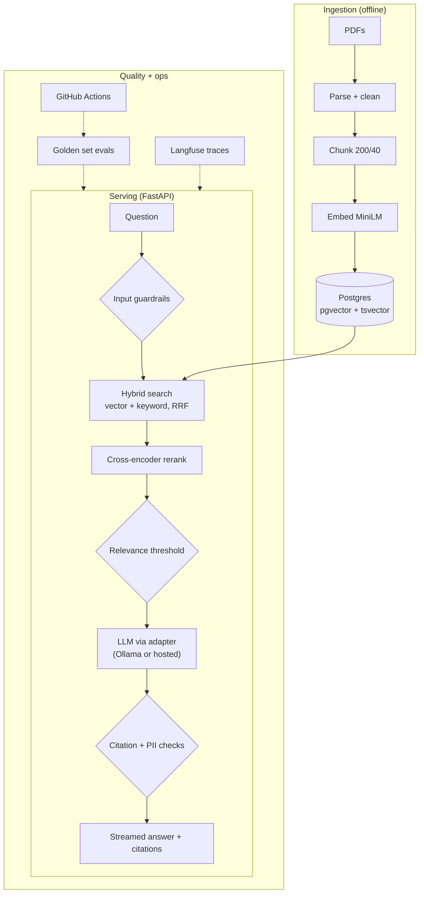

# Day 14: Capstone

**Goal:** package the project so a hiring manager understands it in two minutes and an engineer can run it in five.

## What you'll study

- Writing a README that **sells** the project
- Telling the story with **numbers**
- Recording a short **demo**
- Preparing **interview answers** about your design choices

## Explained simply

### The README is a movie trailer
Nobody reads a 3,000-word README. A trailer shows the best moments in the first 30 seconds. Your README's first screen should answer:
1. **What is it?** One sentence.
2. **Does it work?** A demo GIF or video link.
3. **How good is it?** The results table.
4. **How do I run it?** Three commands.

Architecture, design decisions and next steps come after.

### Numbers turn claims into evidence
- Weak: "I built a RAG system with hybrid search and reranking."
- Strong: "Hybrid search raised recall@5 from 0.68 to 0.81 on acronym questions; reranking added 0.06 MRR for 240 ms."

Your eval history from Days 5–11 *is* the story. Use your real numbers, not these examples.

### Every choice is an interview question
"Why chunk size 200?" "Why pgvector and not Pinecone?" "How do you know the judge is reliable?" If you can answer each with **what you tried, what you measured, and why you chose it**, you'll stand out.

## Diagram

The final architecture, for your README:

Diagram source (Mermaid)

## Tools and services

| Tool | Use today |
| --- | --- |
| Loom or QuickTime | Record a 2-minute demo |
| A GIF tool (e.g. Kap) | A short GIF for the top of the README |
| Mermaid | Architecture diagram that renders on GitHub |
| LinkedIn / a blog | Share the write-up |

## What to implement

- [ ] **README rewrite**, in this order:
  - one-sentence pitch + demo GIF + live link
  - results table: every config you tested, with latency
  - quickstart (three commands)
  - architecture diagram (above)
  - "Design decisions": 5–6 bullets, each choice + the measurement behind it
  - "What I'd do next": fine-tuning, larger corpus, better judge
- [ ] Record a 2-minute demo: one good answer with citations, one "I don't know", one blocked injection attempt, then a trace in Langfuse
- [ ] Write a short post: "What moved my RAG recall from X to Y". Share it on LinkedIn with the repo link.
- [ ] Update your resume project entry with 2–3 bullets that include **numbers**
- [ ] Practice answering out loud: "Walk me through your project", "What failed?", "How would you scale it to 1M documents?"
- [ ] Tag a release: `git tag v1.0 && git push --tags`

## Done when

A friend can read the README, watch the demo, run it locally, and explain back to you what it does.

## After the two weeks

- Fine-tune the reranker or a small model with LoRA (Hugging Face `peft`), track runs in MLflow or Weights & Biases, and add it as a new eval row
- Try an agentic version with LangGraph: let the model decide when to search again
- Grow the corpus to a few thousand papers and see what breaks
